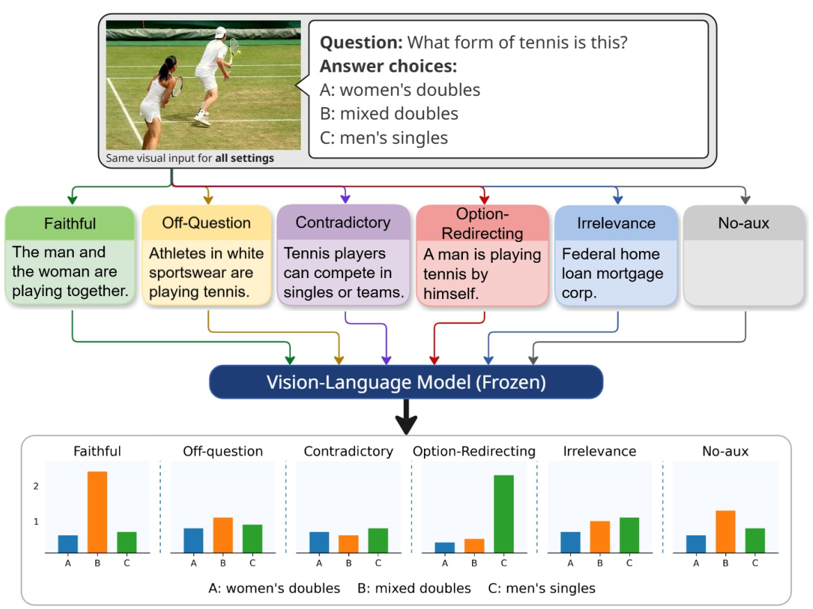

# When Helpful Text Hurts: Option-Redirecting Bias from Auxiliary Text in Vision–Language Models

<!-- [](link-to-paper) -->
[](LICENSE)

Official implementation of "When Helpful Text Hurts: Option-Redirecting Bias from Auxiliary Text in Vision–Language Models".

## 📋 Overview

Vision–Language Models (VLMs) are increasingly deployed in tri-modal visual question answering, where predictions depend on images, questions, and auxiliary text (captions, OCR, metadata). While auxiliary text often improves performance, it can introduce systematic decision bias when imperfect.

<p align="center">
  
</p>

**Key Finding:** The most harmful auxiliary text is not the most incorrect, but the most *question-aligned yet image-inconsistent*—especially when it implicitly supports a specific wrong answer option.

### Main Contributions

- **Textual Reliability Ladder**: A controlled diagnostic framework that factorizes auxiliary-text reliability along three axes: image consistency, question relevance, and option support
- **Option-Redirecting Text Identification**: Discovery of a particularly damaging regime that induces option-targeted collapse rather than diffuse confusion
- **Lightweight Inference-Time Intervention**: A two-stage steering method (NSS + DG) that mitigates option-targeted failures without degrading performance under reliable text

## 🏗️ Architecture

Our method consists of two stages:

1. **Stage 1 - Noise-Stability Steering (NSS)**: Global, static representation shift derived from paired correct/incorrect demonstrations
2. **Stage 2 - Dynamic Grounding (DG)**: Instance-wise, question-aware correction that realigns auxiliary text with visual evidence

## 📊 Textual Reliability Ladder

| Textual Type | Image Grounded | Question Relevant | Supports Wrong Answer | Supports Correct Answer |
|--------------|----------------|-------------------|----------------------|------------------------|
| Faithful | ✓ | ✓ | × | ✓ |
| Off-Question | ✓ | × | × | × |
| Contradictory | × | ✓ | × | × |
| **Option-Redirecting** | × | ✓ | **✓** | × |
| Irrelevant | × | × | × | × |

**Option-Redirecting** text causes the largest performance degradation across multiple VQA benchmarks.

## 🚀 Getting Started

### Prerequisites

```bash
# Install base dependencies
pip install -r requirements.txt

# For Gemini-based textual generation (optional)
pip install google-genai python-dotenv tqdm
```

### Environment Setup

Create a `.env` file in the repository root:

```bash
echo "GEMINI_API_KEY=YOUR_KEY" > .env
# Only needed if using Gemini for caption generation
```

### Supported Models

We evaluate on the following open-source VLMs:

- **InternVL**: `OpenGVLab/InternVL3_5-4B-Instruct`, `OpenGVLab/InternVL3_5-8B-Instruct`
- **Qwen3-VL**: `Qwen/Qwen3-VL-4B-Instruct`, `Qwen/Qwen3-VL-8B-Instruct`
- **Qwen2.5-VL**: `Qwen/Qwen2.5-VL-3B-Instruct`, `Qwen/Qwen2.5-VL-7B-Instruct`

## 📁 Data Preparation

### Option A: Using Pre-generated Data (Recommended)

1. Download the pre-generated data from Google Drive
2. Extract to the following structure:

```
repo/
├── data/
│   └── <dataset>/
│       └── <sample file .json>/
│       └── <image folder>/
│       └── <metadata file .json>/

├── NSS_DG/
│   └── experiments/
│       └── eval/
│           └── internvl.py
│           └── qwen.py
└── src/
    └── preprocess/
        └── [preprocess files]
```

3. Unzip archives:

```bash
# Unzip all data files
find ~/Downloads/nss_data -type f -name '*.zip' -exec unzip -o {} -d . \;

# Extract tar.gz files
find ~/Downloads/nss_data -type f \( -name '*.tar.gz' -o -name '*.tgz' \) -exec tar -xzf {} -C . \;
```

### Option B: Generate Textual Data

Generate auxiliary text with Gemini:

```bash
python src/preprocess/gemini_gen_textual.py \
  --images-root <images_or_keyframes_dir> \
  --question-path <input_questions_json> \
  --answer-path <output_json>
```

**Note**: The script generates `textual_*` fields. Map `textual_redirected` → `caption_redirected` for compatibility.

### Build NSS Demo Samples

Prepare demonstration samples for NSS direction computation:

```bash
python src/preprocess/prepare_data_samples_nss.py \
  --data-path data/data_samples/<dataset>/baseline_gemini_combined.json \
  --images-dir <images_or_keyframes_dir> \
  --output-path NSS_DG/experiments/data/<dataset>/gemini_combined.json
```

## 🔬 Running Experiments

### Inference with NSS + DG

Navigate to the NSS_DG directory:

```bash
cd NSS_DG
```

#### Key Parameters

- `--samples-file`: Demo samples for NSS direction computation
- `--image-folder`: Directory containing images
- `--data-path`: JSON file with metadata
- `--alpha_image`: NSS coefficient for image hidden states
- `--alpha_text`: NSS coefficient for text hidden states
- `--bias_alpha`: DG coefficient for hidden state adjustment
- `--use_bias_reduction`: Enable Dynamic Grounding (DG)
- `--bias_top_k`: Number of top-k image tokens for DG
- `--num_demos`: Number of demonstration samples for NSS
- `--bias_layer_ranges`: Layers to apply DG (e.g., `9-34`)

#### Example: InternVL3.5-4B on A-OKVQA

```bash
CUDA_VISIBLE_DEVICES=0 python experiments/eval/internvl.py \
  --model-path OpenGVLab/InternVL3_5-4B-Instruct \
  --alpha_image 0.3 \
  --alpha_text 0.1 \
  --bias_alpha 0.5 \
  --use_bias_reduction \
  --bias_top_k 7 \
  --num_demos 50 \
  --bias_layer_ranges 9-34 \
  --samples-file experiments/data/aok_vqa/gemini_combined.json \
  --image-folder data/aokvqa/dataset/image/val2017 \
  --data-path data/aok_vqa/baseline_gemini_combined.json \
  --answer-file output/result_internvl_4b.json
```

#### Example: Qwen2.5-VL-7B on ScienceQA

```bash
CUDA_VISIBLE_DEVICES=0 python experiments/eval/qwen.py \
  --model-path Qwen/Qwen2.5-VL-3B-Instruct \
  --alpha_image 0.3 \
  --alpha_text 0.1 \
  --bias_alpha 0.5 \
  --use_bias_reduction \
  --bias_top_k 7 \
  --num_demos 50 \
  --bias_layer_ranges 19-34 \
  --samples-file experiments/data/scienceqa/gemini_combined.json \
  --image-folder data/scienceqa/images \
  --data-path data/scienceqa/baseline_gemini_combined.json \
  --answer-file output/result_qwen_7b.json
```

## 📈 Datasets

We evaluate on four multiple-choice VQA benchmarks:

- **A-OKVQA**: Visual question answering with world knowledge
- **ScienceQA**: Science question answering with diagrams
- **VCR**: Visual commonsense reasoning
- **Causal-VidQA**: Causal reasoning in video QA

Each dataset is evaluated with 1,000 randomly sampled instances under all textual reliability conditions.

## 🔍 Key Insights

1. **Not all text corruption is equal**: Option-redirecting text (question-relevant but image-inconsistent with option support) is far more harmful than generic noise
2. **Scaling doesn't solve the problem**: Larger models can be even more susceptible to option-redirecting bias
3. **Targeted intervention works**: Our method specifically counters option-targeted failures while preserving benefits of reliable auxiliary text

<!-- ## 📝 Citation

```bibtex
@inproceedings{author2026helpful,
  title={When Helpful Text Hurts: Option-Redirecting Bias from Auxiliary Text in Vision--Language Models},
  author={Author Name},
  booktitle={Proceedings of the International Joint Conference on Artificial Intelligence (IJCAI)},
  year={2026}
}
``` -->

## 📄 License

This project is licensed under the MIT License - see the [LICENSE](LICENSE) file for details.

## 🙏 Acknowledgments

We thank the creators of A-OKVQA, ScienceQA, VCR, and Causal-VidQA datasets, and the developers of InternVL and Qwen models.

## 📧 Contact

For questions or issues, please open an issue on GitHub or contact [tranvanhoangdpe@example.com](mailto:email@example.com).

---

**Note**: This is research code. For production deployment, additional robustness testing and safety considerations are recommended.